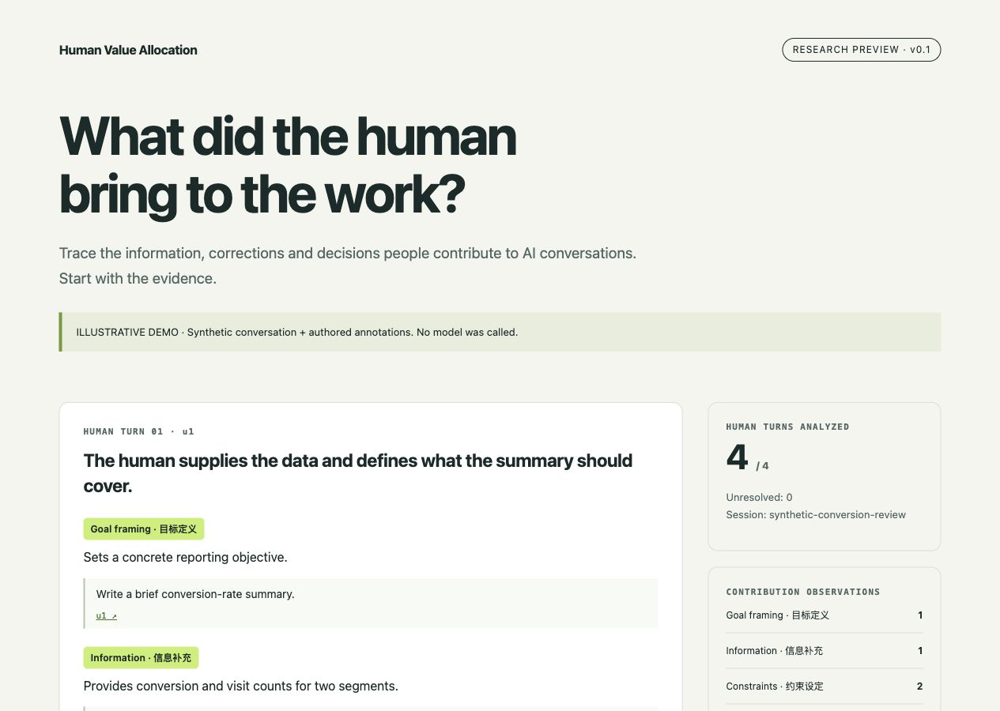

# Human Value Allocation

**What did the human bring to the work?**

Evidence-linked analysis of human contributions in human–AI conversations.
Import a dialogue, inspect each human turn, and follow every observation back to the source text.

**Research preview · v0.1.0a1 · Python 3.10+ · MIT**

[中文说明](README.zh-CN.md) · [Example report](https://kling01.github.io/human-value-allocation/) · [Evaluation rubric](src/human_value/evaluator.yaml) · [Method & limits](docs/method.md) · [Paper](https://arxiv.org/abs/2610.26365)

Related paper: *From Tasks to Turns: Measuring Human Labor Contributions in Human–Agent Joint Production* studies Human-Turn-level quality and remaining computation; this preview provides descriptive contribution analysis and does not yet implement the paper's measurement protocol.



## Try it in one minute

```bash
git clone https://github.com/kling01/human-value-allocation.git
cd human-value-allocation
python -m venv .venv
source .venv/bin/activate
python -m pip install .
hva demo --out outputs/demo
```

Open `outputs/demo/report.html` in your browser. The demo is fully offline and uses a synthetic conversation with **authored illustrative annotations**, not a model prediction or benchmark result.

## Analyze your own conversation

Configure a model through an OpenAI-compatible Chat Completions endpoint that supports JSON-object output:

```bash
export HVA_BASE_URL="https://api.openai.com/v1"
export HVA_MODEL="your-model-id"
# Set HVA_API_KEY in your environment using your own provider credential.
hva analyze examples/conversation.json --out outputs/my-first-analysis
```

`analyze` sends the supplied conversation to the provider **you configure**. There is no HVA-hosted upload endpoint or telemetry. Reports are local, contain source dialogue, and are only shared when you choose to share them. A new output directory is required for each run.

Outputs:

- `report.html`: a standalone report with source-linked observations and visible followup.
- `report.json`: machine-readable results, rubric fingerprint, unresolved turns, and provider usage when available.

The analyzer makes one logical model call per human turn, with at most one retry for transient request errors. Default concurrency is four. Missing usage remains unknown. This usage is the **cost of running the analyzer**, not the human's token-equivalent value.

Remote endpoints require HTTPS by default. `--allow-insecure-http` explicitly opts into an HTTP gateway you trust; loopback HTTP endpoints are accepted for local models.

## What v0 analyzes

| Contribution | What to look for |
|---|---|
| Goal framing | A concrete objective or useful task decomposition |
| Information | Relevant facts, source material or domain context |
| Constraints | Requirements, boundaries and acceptance criteria |
| Correction | A specific error or mismatch, with uncertainty stated |
| Decision | A substantive choice or tradeoff |
| Verification | An actual check, test result or grounded acceptance judgment |

For each turn, the report separates the human's contribution from what the assistant visibly did next. Evidence quotes are checked against the permitted source messages. An invalid quote or failed API call produces an unresolved turn, not a zero-value score.

**“Allocation” is the research direction. This release provides descriptive analysis.** It does not estimate causal credit, saved tokens, task-quality gains, monetary value or percentage ownership. Category counts overlap and must not be summed into a value score. The rubric is an initial operational definition; its accuracy and agreement with human raters have not yet been established.

## Input format

```json
{
  "id": "my-session-full-id",
  "messages": [
    {"id": "u1", "role": "user", "content": "Please compare these two options."},
    {"id": "a1", "role": "assistant", "content": "Here is a comparison..."}
  ]
}
```

Each message has exactly `id`, `role`, and text `content`. Roles: `user`, `assistant`, `system`, `tool`. Message IDs must be unique within the session; full IDs are preserved. v0 accepts one text conversation, up to 50 human turns and 200,000 content characters. Unsupported or excessive input is rejected without silent truncation. Native tool-call trees, attachments and multimodal inputs need an adapter and are not supported by this release.

## Built on agent-eval-v2

```text
Dialogue JSON → adapter → shared cleaner → agent-eval-v2 run_combined
              → evidence validation → local HTML + JSON
```

The repository includes a namespaced, sanitized subset of the evaluation engine. The analysis layer adds the human-contribution rubric and report; it does not introduce a parallel judge. Model settings are explicit per run. No business configurations, production traces, database adapters, private endpoints or embedded credentials are included. See [engine provenance](ENGINE_PROVENANCE.md).

## Development

```bash
python -m pip install -e '.[dev]'
python -m pytest -q
python scripts/audit_release.py
python -m build
```

Tests cover source evidence, temporal boundaries, full IDs, failed evaluations, HTML escaping, shared-engine integration and request retry accounting. Mocked integration tests verify software behavior, not model accuracy.

See the [release validation record](docs/validation.md) for isolated installation and live smoke checks.

## Next experiments

- Human review of the rubric across several task types.
- Counterfactual replay protocols and task-specific quality measures.
- Token-equivalent contribution estimates only after those measures are validated.

If you try this on a conversation, useful feedback is **which observation you disagree with and why**. Share synthetic or appropriately redacted examples in [Issues](https://github.com/kling01/human-value-allocation/issues). Improvements to the rubric and input adapters are welcome.
