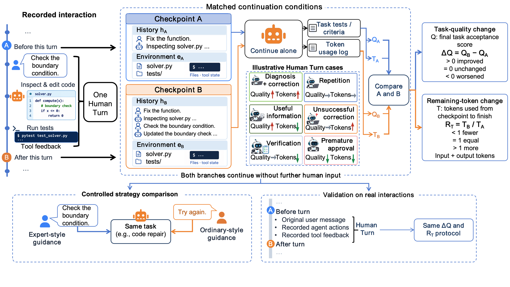
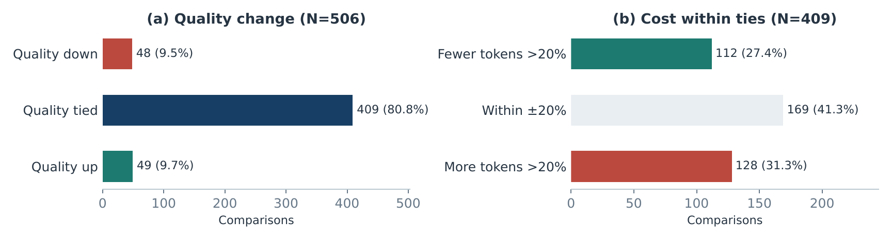

# 人类价值分配 · Human Value Allocation

**这段 AI 对话的成果里，你贡献了什么？**

导入一段对话，逐轮分析人类提供的信息、约束、纠正、决策和检验，生成可以回到原文核对的报告。

这是 **v0.1 研究预览版**。当前实现贡献分析，尚不预测“这句话值多少 token”，也不计算因果贡献、质量收益或价值百分比。评估标准尚待真人标注校准。

[查看示例报告](https://kling01.github.io/human-value-allocation/) · [评估器全文](src/human_value/evaluator.yaml) · [English](README.md) · [论文](https://arxiv.org/abs/2610.26365)

相关论文 *From Tasks to Turns: Measuring Human Labor Contributions in Human–Agent Joint Production* 研究 Human-Turn 级的质量与剩余计算量测度；当前预览版提供描述性贡献分析，尚未实现论文中的测量协议。

## 论文研究框架



**论文图 1。** 在模型、预算与终止条件匹配的情况下，从相邻检查点独立续跑，比较最终任务质量与剩余 token 用量；同一框架也用于受控指导策略比较和真人来源交互验证。当前工具预览版提供描述性对话分析，尚未把这一续跑测量协议实现为 CLI 功能。

<details>
<summary><strong>论文结果：最终质量相同，剩余工作量也可能不同</strong></summary>



**论文图 5 — HumanBench。** 来自 85 个真人来源会话的 506 次联合有效比较中，49 次最终质量提高、409 次持平、48 次下降。在 409 次质量持平的比较中，112 次剩余 token 减少超过 20%，169 次变化在 ±20% 以内，128 次增加超过 20%。该持平子集覆盖 48 个根任务和 82 个来源会话。这说明有必要同时测量质量与计算投入；图中结果不代表当前仓库分析器的性能，也不是人类输入的货币估值。

协议、样本与限制见[论文](https://arxiv.org/abs/2610.26365)；[图片来源说明](docs/paper/README.md)。

</details>

## 先跑示例

```bash
git clone https://github.com/kling01/human-value-allocation.git
cd human-value-allocation
python -m venv .venv
source .venv/bin/activate
python -m pip install .
hva demo --out outputs/demo
```

打开 `outputs/demo/report.html`。这是合成对话与人工编写的示意标注，完全离线，不调用模型。

## 分析自己的对话

在环境变量中配置 `HVA_API_KEY`、`HVA_BASE_URL`、`HVA_MODEL`，使用支持 JSON 输出的 OpenAI 兼容接口：

```bash
hva analyze examples/conversation.json --out outputs/my-analysis
```

对话会发送到你配置的模型服务。工具不设集中上传服务，不采集遥测；报告保存在本地，包含原文。输入格式见英文 README，首版只支持文本消息。

报告包含每轮贡献类型、原文引用、后续模型是否可见地采纳，以及证据限制。引用必须在指定原文中找到；接口失败或证据不匹配会单独标记，不能解释成人类贡献为零。

底层复用经过清理的 agent-eval-v2 清洗器与评测引擎。API token 用量仅表示分析器自身的推理开销，不代表人类劳动价值。

最有帮助的反馈是：**你不同意报告里的哪一个判断，为什么？** 欢迎在 Issues 提供合成或已脱敏的例子。
